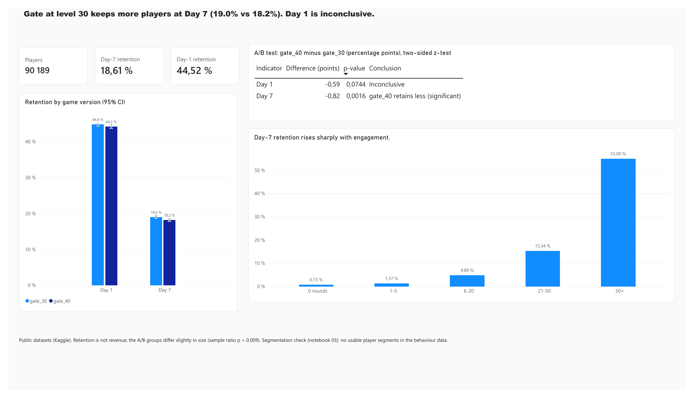
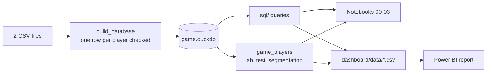

# Game Player Analytics

[](https://github.com/DJ-Papy/game-player-analytics/actions/workflows/ci.yml)

**Scenario.** The team of a mobile puzzle game moved the first gate (the level where players must wait or pay to continue) from level 30 to level 40 for half of new players, and asks whether to keep the change. A second question: can players be grouped into segments for targeted offers?
**Data.** The Cookie Cats A/B test (90,189 players) and a player behaviour dataset (40,034 players), both public. SQL (DuckDB), Python, Power BI.

**Dashboard:** [`docs/dashboard.pdf`](docs/dashboard.pdf) · Power BI file: `dashboard/game-player-analytics.pbix`



## Recommendations

1. **Keep the first gate at level 30.** With the gate at level 40, D7 retention falls from 19.02% to 18.20% (−0.8 point, p = 0.0016, bootstrap interval excludes 0). D1 shows no significant difference.
2. **Before acting on it, check the assignment and the revenue.** The groups differ by 789 players (sample ratio p = 0.009), and the dataset has no revenue: a later gate could change purchases in a way retention does not show.
3. **Do not build targeted offers on the behaviour segments.** K-means finds no more structure in this data than in shuffled data; the dataset looks simulated.

## Key results

| Question | Answer |
|---|---|
| Does moving the first gate from level 30 to 40 change retention? | **Day 7: yes, slightly worse.** 19.0% (gate_30) vs 18.2% (gate_40), p = 0.0016, bootstrap CI excludes 0. **Day 1: inconclusive** (44.8% vs 44.2%, p = 0.074). |
| How does engagement relate to retention? | Day-7 retention rises from 0.7% (0 rounds) to 55.0% (50+ rounds). This is a correlation, partly mechanical: rounds are counted over the first 14 days, so a player who comes back on day 7 has more days left to play. |
| Are there distinct player segments? | **No usable structure.** Same silhouette as on shuffled data. The three groups kept (highly active non-payers 39%, low-activity non-payers 40%, payers 20%) are descriptive only. |

## How the analysis is built



| Decision | Reason |
|---|---|
| Sample ratio checked before the test | an unbalanced split can bias the comparison |
| Two indicators tested, threshold 0.025 (Bonferroni) | testing D1 and D7 at 0.05 each would double the risk of a false positive |
| z-test confirmed by a bootstrap (5,000 resamples, seed 42) | the bootstrap does not rely on the normal approximation |
| Outlier (49,854 rounds) kept in rates, excluded from round statistics | one player out of 90,189 does not move a rate but distorts an average |
| Segments compared with shuffled data and across seeds | K-means always returns clusters, even on noise |

## Limitations

- The A/B test measures retention, not revenue.
- The groups are slightly unbalanced (p = 0.0086): the assignment should be verified before a production decision.
- **The behaviour dataset looks simulated** (near-zero correlations, flat distributions). The segments separate payers from non-payers and session frequency; they demonstrate the method, not real player types.

## Repository

```
src/game_players/   package: database build and checks, A/B test, segmentation, dashboard export
sql/                retention queries (KPIs, groups, engagement bands and quartiles, outliers)
notebooks/          data loading, retention, A/B test, segmentation check
tests/              unit and end-to-end tests, run by CI on every push
dashboard/          Power BI report and the CSV files it reads
docs/               dashboard export (PDF, PNG)
data/               data sources and licences, raw behaviour file
```

## Run it

```powershell
python -m venv .venv
.venv\Scripts\Activate.ps1
pip install -e ".[notebooks,dev]"
# download cookie_cats.csv into data/raw/ (link in data/README.md); the behaviour file is already there
python -m game_players build   # game.duckdb, data checks, dashboard/data/*.csv
pytest                         # tests (no download needed)
jupyter lab                    # notebooks 00 to 03
```

## Data and licence

Cookie Cats A/B test (Kaggle, originally DataCamp; licence not stated, so the file is not republished here) and Predict Online Gaming Behavior (Kaggle, MIT). Details in [`data/README.md`](data/README.md).
